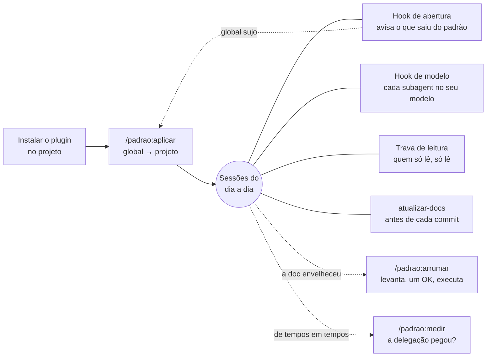
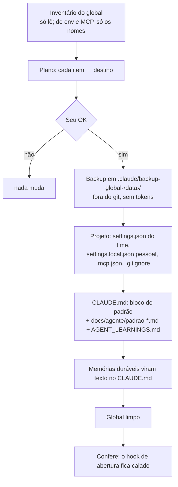
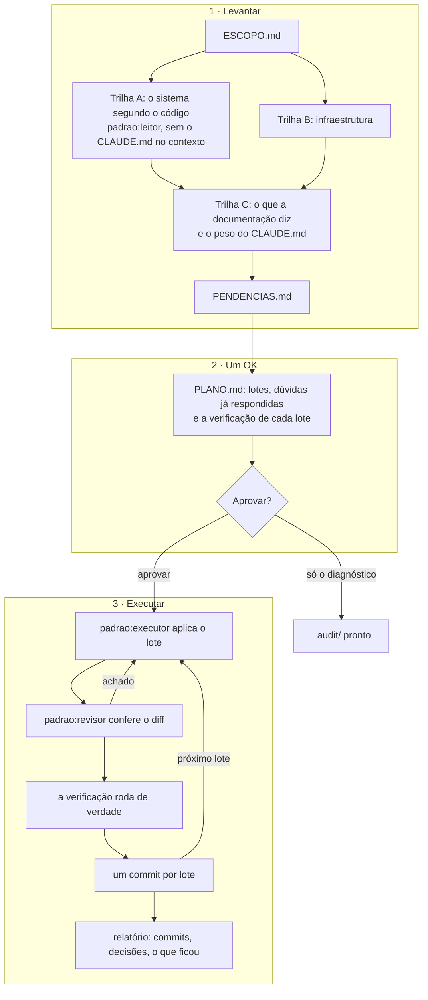
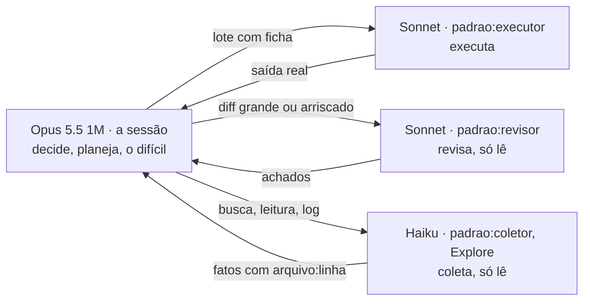
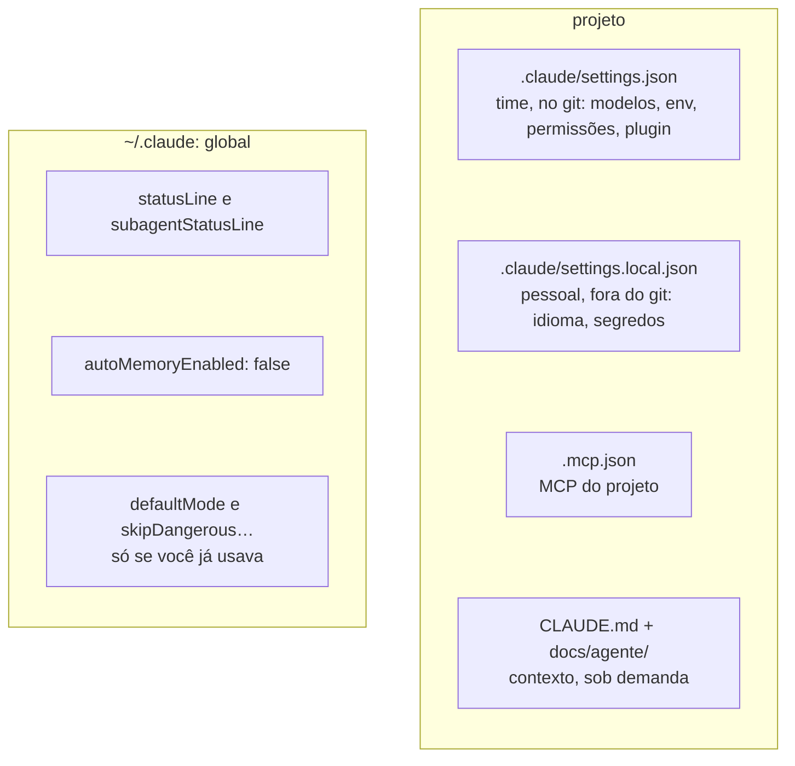

# padrao

[](https://github.com/Kortek-Tecnologia/claude-padrao/actions/workflows/testes.yml)

Plugin de [Claude Code](https://code.claude.com) que deixa todo projeto no mesmo padrão:
configuração **no projeto** e global limpo, modelos da **família 5.5** com papéis fixos — **Opus
decide, Sonnet executa lote com ficha, Haiku coleta** — e documentação curta e
verdadeira. Funciona no Windows (Git Bash) e no Linux.

- [O que ele resolve](#o-que-ele-resolve)
- [Visão geral](#visão-geral)
- [Os três comandos](#os-três-comandos)
- [O que roda sozinho](#o-que-roda-sozinho)
- [Modelos e delegação](#modelos-e-delegação)
- [Onde mora cada configuração](#onde-mora-cada-configuração)
- [Instalar](#instalar) · [Atualizar](#atualizar) · [Segurança e limites](#segurança-e-limites)
- [Desenvolver](#desenvolver) · [Licença](#licença)

## O que ele resolve

| Problema | O que o padrão faz |
|---|---|
| Configuração solta no `~/.claude` muda o comportamento de um projeto para outro sem ninguém ver | Leva tudo para o projeto, versionado; o global fica só com a interface do terminal |
| O Opus, o modelo caro, fazendo trabalho braçal — ler arquivo, varrer log — e subagents herdando o modelo da sessão | Papel fixo por modelo, travado por hook; quem só coleta roda em Haiku |
| Documentação que mente (porta errada, comando velho) e `CLAUDE.md` inchado, pago em toda sessão | `/padrao:arrumar` levanta e corrige com um OK; antes de cada commit, a doc que o diff deixou falsa é corrigida |

## Visão geral



## Os três comandos

| Comando | Quando | Pergunta |
|---|---|---|
| `/padrao:aplicar` | ao adotar o padrão, ou quando o hook de abertura avisar | um OK no plano |
| `/padrao:arrumar [foco]` | quando a documentação ou o `CLAUDE.md` envelhecerem | um OK no plano |
| `/padrao:medir` | para ver se a política de modelos pegou | nenhuma |

### `/padrao:aplicar` — o global vai para o projeto



| Item do global | Vai para |
|---|---|
| `model`, `effortLevel`, `modelSettings`, `fallbackModel`, `cleanupPeriodDays` | descartados: o padrão fixa |
| `env`, `hooks`, `permissions.deny/ask`, `enabledPlugins` | `.claude/settings.json` (time, no git) |
| `env` com nome de segredo (TOKEN, KEY, SECRET, PASS, URL…), idioma, tema | `.claude/settings.local.json` (pessoal, fora do git) |
| `permissions.allow` | pergunta regra a regra: do time ou pessoal |
| `CLAUDE.md` global, memórias | `CLAUDE.md` do projeto, só o que é fato durável dele |
| agents, skills, commands, rules | `.claude/` do projeto que usa |
| MCP de escopo user ou local | `.mcp.json` do projeto (segredo por `${VAR}`) |
| plugins do escopo user | `claude plugin install … --scope project` |

O bloco que entra no `CLAUDE.md` é curto: o detalhe fica em arquivos lidos **sob demanda**,
listados num índice "arquivo → quando ler" (sem `@import`, que carregaria tudo em toda sessão).

### `/padrao:arrumar` — levantar, um OK, executar tudo



- **Uma pergunta só.** O levantamento só lê e não pergunta nada; cada dúvida chega ao OK já com
  a resposta recomendada, e você aprova tudo, escolhe alguns lotes ou pede só o diagnóstico.
- **O que muda:** documentação, `CLAUDE.md` (o que não vale em toda sessão vai para
  `docs/agente/<tema>.md`, apontado por um índice) e infraestrutura. Código, só comentário e
  docstring; regra documentada que o código contraria fica, e o código vai para o relatório.
- **Seguro de desfazer:** um commit por lote no branch `padrao/arrumar-<data>`, sem push;
  `git revert <hash>` desfaz um lote. O
  rascunho fica em `_audit/` (fora do git) e, se a execução parar, rodar de novo retoma.
- **Foco opcional:** `/padrao:arrumar só docs`, `só infra`, `só o CLAUDE.md`.

### `/padrao:medir` — a delegação pegou?

Lê os transcripts locais do projeto (últimos 14 dias) e mostra quem fez o quê:

```
hook de modelo: 1 correção(ões) de papel fixo (Explore=1) · 1 recusa(s)
subagents (tipo: modelo em que rodou × chamadas):
  Explore              haiku=1
  padrao:executor      sonnet=3
  padrao:revisor       sonnet=3
tokens por modelo (entrada · cache lido · saída):
  principal  claude-opus-5-5        125k · 2.8M · 50k
  subagents  claude-sonnet-5-5      74k · 203k · 9k
  subagents  claude-haiku-5-5       32k · 78k · 9k
custo estimado a preço de lista (em assinatura é peso relativo, não cobrança):
  principal  claude-opus-5-5        US$ 2.11
  subagents  claude-sonnet-5-5      US$ 0.29
  subagents  claude-haiku-5-5       US$ 0.01
  total      US$ 2.41 · subagents 12%
contexto por requisição da sessão principal (requisições · % do custo dela):
  até 100K         15 · 46%
  100–200K         9 · 54%
  200–400K         0 · 0%
  400–600K         0 · 0%
  acima de 600K    0 · 0%
Haiku acima de 100K: 0 de 4 requisições · sobrepreço US$ 0.00
```

Haiku perto de zero com muita entrada no Opus = leitura que devia ter ido ao coletor. O custo é
estimativa a preço de lista; o que mais pesa é o contexto grande na sessão principal.

## O que roda sozinho

| Peça | Quando | O que faz |
|---|---|---|
| Hook de abertura | toda sessão | avisa (nunca corrige) se algo voltou para o global, se o projeto saiu do padrão, se o bloco do `CLAUDE.md` ou os `docs/agente/padrao-*.md` são de outro modelo, ou se há versão nova do plugin |
| Hook de modelo | toda chamada de subagent | corrige o modelo dos papéis fixos e recusa modelo fora da política |
| Trava de leitura | Bash, MCP e ferramentas que gravam, nos agentes que só leem | deixa `Explore`, coletor, leitor e revisor só lerem: grava, redireciona ou executa → recusa, dizendo o motivo |
| `atualizar-docs` | antes de cada commit | corrige só a documentação que o diff deixou falsa (porta, comando, variável, caminho) |
| Status lines | sempre | modelo, effort, contexto, limites e cache na linha; uma linha por subagent |

```
Opus 5.5 · loja · main · medium
ctx █░░░░░░░░░ 12% 120k/1M  │  5h ███░░░░░░░ 31% (resets 2h10m)  │  cache 4:12 of 5m
padrao:coletor · Haiku 5.5 · medium · ctx 4% (42k) · 1m15s · lendo app.py
```

Modelo em vermelho fora do Opus 5.5 1M; em amarelo o que é ajuste só da sessão (effort fora de
medium, Fable 5.2); "sem padrão" na pasta sem o plugin; nos subagents, vermelho fora dos modelos
fixados. Como cada hook decide: [docs/como-funciona.md](docs/como-funciona.md).

## Modelos e delegação



- Tudo na **família 5.5 com 1M de contexto**, effort **medium**. Toda sessão abre em medium; o
  `/effort` muda só a sessão em curso (o projeto vence o global na próxima).
- **Teto de 400K no Opus:** a compactação automática da sessão dispara aos 400K tokens
  (`modelSettings["claude-opus-5-5"].autoCompactWindow`), não perto de 1M — cada requisição relê
  o contexto inteiro. O bloco do `CLAUDE.md` diz o que preservar ao compactar. Sessão que precisar
  de mais: `claude --autocompact 1M`.
- **Lote com ficha vai para o executor.** Lote com ficha fechada (arquivos, mudança, critério de
  aceite, verificação que roda) vai para o `padrao:executor` quando tem muitos passos ou a sessão
  já está longa: cada requisição da sessão relê o contexto inteiro dela. Em sessão curta, o lote
  de poucas chamadas a própria sessão faz. Diff grande ou arriscado passa pelo `padrao:revisor`
  antes do commit.
- **Tarefa que pede mais**, um degrau por vez: um teste que rode; um nível de effort
  (`/effort high`, ou `ultrathink` no prompt para um turno); passou de high, o Fable 5.2 só na
  sessão (`/model`, tecla `s`) em medium, em vez de xhigh ou max — custa o dobro do Opus em
  entrada e saída (o cache lido custa o mesmo) e, conforme o plano, consome créditos de uso. Troque depois de `/compact`: o cache é por
  modelo. Em subagent o Fable é recusado.
- Os aliases `opus`, `sonnet`, `haiku` e `fable` apontam fixo para a 5.5 e o Fable 5.2
  (`ANTHROPIC_DEFAULT_*_MODEL`): não mudam sozinhos quando sai versão nova. Sem `fallbackModel`,
  indisponibilidade não troca de modelo; a única troca automática é a de segurança (mensagem
  sinalizada é refeita num modelo anterior, com aviso no transcript).
- Subagent sem `model` roda em Sonnet (`CLAUDE_CODE_SUBAGENT_MODEL`), não no Opus da sessão;
  subagent não abre subagent (`CLAUDE_CODE_MAX_SUBAGENT_SPAWN_DEPTH=1`).
- Agentes do plugin: `padrao:coletor` e `padrao:leitor` (haiku, só leem; o leitor roda sem o
  `CLAUDE.md`, para análise que não pode se contaminar pela documentação), `padrao:executor` e
  `padrao:revisor` (sonnet).

## Onde mora cada configuração



O plugin não traz essas settings prontas porque o Claude Code descarta `model`, `effortLevel` e
afins quando vêm de plugin (só `agent` e `subagentStatusLine` valem). Por isso o `aplicar` as
grava no `.claude/settings.json` do projeto, que vence o global a cada abertura — mesmo depois
de um `/model`. O padrão não liga bypass de permissões nem desliga os checkpoints (`/rewind`);
auto memory fica desligado e o contexto do projeto vive no `CLAUDE.md`.

## Instalar

Requisitos:

- Claude Code **v2.1.317+** (antes dela, subagent herda o effort da sessão em vez do effort do
  próprio modelo); o Fable 5.2 pede a v2.1.321.
- Windows: **Git Bash** (os hooks rodam em `bash`).
- **jq** — `winget install jqlang.jq` | `sudo apt install jq`. Sem ele, os agentes que só leem
  ficam sem Bash e o hook de abertura se cala: falha fechado.
- **Python 3.9+** para as skills (`scripts/py.sh` acha `python3`, `python` ou `py`).
- **GNU sed 4.3+ e gawk** para os agentes que só leem usarem sed e awk (só com `--sandbox`; o Git
  Bash traz os dois). Com o mawk, padrão do Debian/Ubuntu, o awk deles fica negado.

Do diretório do projeto, escopo de projeto (nada no global):

```
claude plugin marketplace add Kortek-Tecnologia/claude-padrao --scope project
claude plugin install padrao@claude-padrao --scope project
```

Depois, numa sessão: `/padrao:aplicar`. Quem clonar um projeto que já tem o padrão recebe o
plugin ao abrir — o `.claude/settings.json` declara o marketplace —, depois de aceitar o
diálogo de confiança da pasta. Em `claude -p` esse diálogo não aparece: use os dois comandos.

## Atualizar

O `.claude/settings.json` do padrão liga `autoUpdate` no marketplace `claude-padrao`. O Claude
Code busca a versão nova até 10 min depois da primeira mensagem; a sessão aberta segue na antiga
até `/reload-plugins`. Se a instalada ficar atrás, o hook de abertura avisa com o comando:

```
claude plugin update padrao@claude-padrao --scope project
```

Projeto sem `autoUpdate` (instalado antes de o padrão gravá-lo) não recebe sozinho — o hook
avisa: rode o comando acima uma vez e depois `/padrao:aplicar`. Mudou o bloco do `CLAUDE.md` ou
os `docs/agente/padrao-*.md` numa versão nova: o hook de abertura avisa (compara o carimbo
`modelo X` da primeira linha de cada um) — rode `/padrao:aplicar` de novo no projeto, que os
regrava.

**Projeto de um marketplace antigo** (`padrao@kortek-tools` ou `padrao@padrao`), de dentro dele:

```
claude plugin uninstall padrao@kortek-tools --scope project
claude plugin marketplace add Kortek-Tecnologia/claude-padrao --scope project
claude plugin install padrao@claude-padrao --scope project
```

Depois `/padrao:aplicar` troca o `extraKnownMarketplaces` e o `enabledPlugins`.

## Segurança e limites

- **Trava de leitura, fechada por padrão.** Cada segmento do comando precisa começar por um
  leitor conhecido e não gravar; sed e awk só com `--sandbox`. Se o próprio hook falhar, a
  chamada é bloqueada. Fica um caso: entrar (`cd`, `git -C`) num repositório bare versionado com
  config hostil — `git config --global safe.bareRepository explicit` fecha.
- **Segredos:** o inventário e o `arrumar` nunca imprimem valor de variável; o backup não leva o
  `~/.claude.json`.
- **Windows, caminho com mais de 260 caracteres:** o Python não enxerga (projeto em pasta muito
  funda). O `aplicar` confere pelo Bash o que o hook acusa; o `/padrao:medir` responde "sem
  transcripts".

## Desenvolver

```
.claude-plugin/   manifesto do plugin e do marketplace (version: semver)
hooks/            hooks.json: abertura, modelo do subagent, trava de leitura
scripts/          os hooks em sh, py.sh e testar.sh
agents/           coletor, leitor, revisor, executor
skills/           aplicar (+ inventário e modelos), arrumar, medir, atualizar-docs
statusline/       status line principal e dos subagents
docs/             como funciona por dentro
.github/          CI: testes e validação dos diagramas
```

```
bash scripts/testar.sh
claude plugin validate .
```

O CI (Ubuntu) roda o `testar.sh` e valida os diagramas Mermaid a cada push. Publicar: suba a `version` em
`.claude-plugin/plugin.json` — o aviso de versão nova compara com ela — e dê push. Mudou um
modelo que vai para o projeto (`skills/aplicar/modelos/`): suba também o carimbo dele. Detalhes,
árvore de decisão de cada hook e o teste de ponta a ponta das skills:
[docs/como-funciona.md](docs/como-funciona.md).

## Licença

MIT ([LICENSE](LICENSE)). A status line principal (`statusline/statusline.py`) é de
[Jhonatan de Souza](https://github.com/Jhonatan-de-Souza/claude-code-statusline) (commit
44e9e48), embutida com crédito e permissão do autor, e fica fora da licença MIT deste
repositório.
