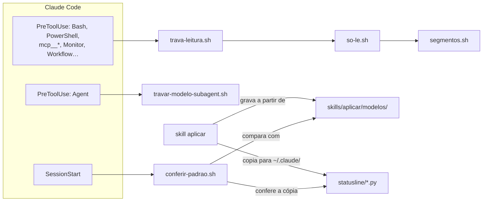
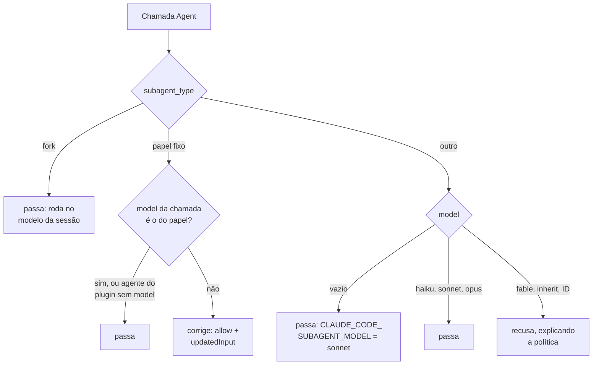
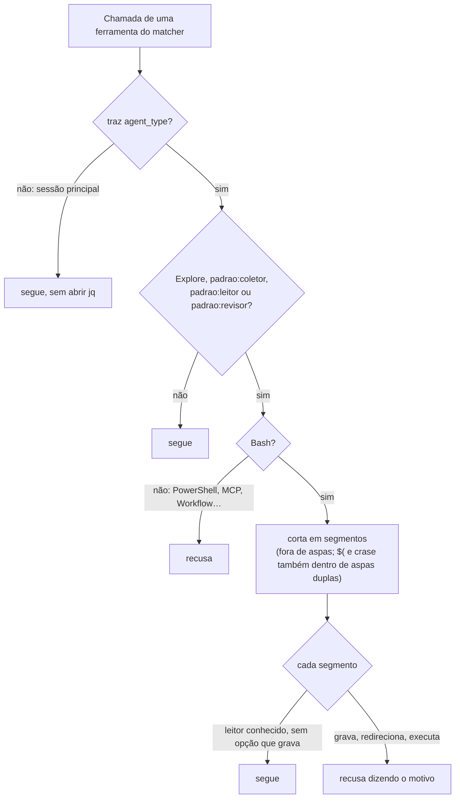
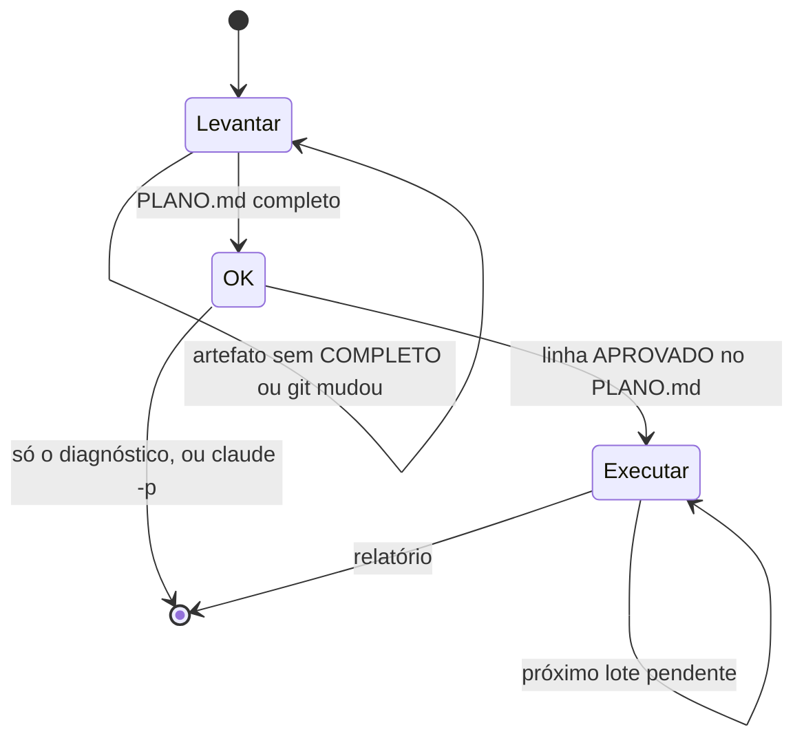

# Como funciona por dentro

Para quem mantém o plugin. O uso está no [README](../README.md); a regra exata de cada hook está
no cabeçalho do script dele — aqui fica como as peças se ligam e por quê.

## As peças

| Caminho | Papel |
|---|---|
| `hooks/hooks.json` | liga os três hooks; todos com `shell: bash` e timeout de 10 s; os de PreToolUse com `onFailure: "block"` (falhou, bloqueia) |
| `skills/aplicar/modelos/` | **fonte única** do padrão: o `aplicar` grava a partir dela e o hook de abertura compara com ela |
| `scripts/py.sh` | acha `python3`, `python` ou `py` 3.9+ (no Windows o `python3` costuma ser o atalho quebrado da Store) e roda com `-I` |
| `agents/*.md` | os quatro agentes; os que só leem têm `tools` fechado e `disallowedTools` |
| `statusline/` | `statusline.py` é de terceiro (Jhonatan de Souza); nossas linhas ficam entre `padrao: início` e `padrao: fim` ou marcadas `# padrao` |

## Hook de abertura — `conferir-padrao.sh`

Roda a cada `startup` e `resume`, e a primeira resposta espera por ele (~1 s). **Só avisa**: o
que achar vai ao usuário (`systemMessage`) e ao Claude (`additionalContext`), apontando o
`/padrao:aplicar`. Sem `jq`, fica calado.

| Confere | Contra |
|---|---|
| `model`, `effortLevel`, `modelSettings` (todos os campos que o modelo define em cada modelo, inclusive `autoCompactWindow`; campo ou modelo só do projeto não conta) e as chaves de `env` do projeto | `modelos/settings.json` |
| `fallbackModel` em `settings.json` ou `settings.local.json`; `CLAUDE_CODE_DISABLE_FILE_CHECKPOINTING` | têm de estar ausentes |
| `disableClaudeAiConnectors` (projeto) e `syncClaudeAiPlugins: false` (local, único lugar em que vale) | `true` / `false` |
| `~/.claude/settings.json` | só `permissions.defaultMode`, `skipDangerousModePermissionPrompt`, `autoMemoryEnabled`, as status lines e o effort que o `/effort` salva (o projeto vence) |
| `~/.claude/` | sem `CLAUDE.md`, agents, commands, rules, workflows, skills pessoais (menos `synced/` e ocultas), status lines diferentes das do plugin |
| `~/.claude.json` e `~/.claude/projects/<chave>/memory` | sem MCP de escopo user nem local deste projeto; sem memória deste projeto |
| versão instalada × `~/.claude/plugins/marketplaces/claude-padrao` | por **diferença**, não por ordem: a numeração recomeçou em 1.0.0 |
| carimbo `modelo X` do bloco do `CLAUDE.md` e dos `docs/agente/padrao-*.md` do projeto | o da 1ª linha do arquivo em `modelos/`; só o carimbo, não o texto — quem grava no projeto é o Claude, e espaço ou CRLF dariam aviso falso. A marca vale só no começo da linha (prosa que cita o marcador não conta), e carimbo mais novo que o do plugin manda atualizar o plugin, não rodar o `aplicar` |

## Hook de modelo — `travar-modelo-subagent.sh`

| Papel fixo | Modelo |
|---|---|
| `Plan` | opus |
| `Explore`, `padrao:coletor`, `padrao:leitor` | haiku |
| `padrao:executor`, `padrao:revisor` | sonnet |

- **Precedência do modelo** no Claude Code: `model` da chamada > `model:` do frontmatter >
  `CLAUDE_CODE_SUBAGENT_MODEL` > modelo da sessão. Por isso os agentes do plugin sem `model` passam
  (o frontmatter já tem o certo) e o hook só age quando a chamada traz outro.
- O `Explore` embutido roda no `opus` por padrão: daí a correção sempre.
- `fable` segue recusado em subagent: é o último degrau de escalada da **sessão** (`/model` com
  `s`; amarelo na status line), e o alias está fixado no Fable 5.2 só para não mudar sozinho.
- A correção devolve a entrada inteira com o `model` trocado (`updatedInput` substitui a entrada).
- **Sem jq** não dá para reescrever: os campos saem por regex e o papel fixo fora do modelo é
  recusado com o modelo certo na mensagem.

## Trava de leitura — `trava-leitura.sh` → `so-le.sh` → `segmentos.sh`

- **Matcher** (`hooks.json`): Bash, PowerShell, `mcp__*` e as embutidas que executam, gravam ou
  falam com fora (Monitor, Workflow, CronCreate/Delete, RemoteTrigger, Enter/ExitWorktree,
  SendMessage, SendToProject*, PushNotification, TaskStop). Ferramenta nova desse tipo entra
  ali. Não é `*` de propósito: cada chamada custa ~90 ms no Windows.
- **Lista de leitura** (`so-le.sh`): `cat grep head tail wc ls stat diff cmp echo printf jq test
  readlink realpath basename dirname cd pwd cut tr column nl`, mais estes com checagem:

| Comando | Recusado quando |
|---|---|
| `sed`, `awk` | sem `--sandbox` logo após o nome; com `-i` (sed) ou `-d/-p/-o/-D` (gawk), que o sandbox não impede |
| `git` | subcomando fora de `log show diff blame grep status ls-files ls-tree rev-parse rev-list cat-file shortlog merge-base name-rev describe`; `-c`, `--config-env`, `--output`, `--ext-diff`, `--exec-path`, `--git-dir`, `--work-tree`, `-O` |
| `sort`, `uniq`, `find`, `file`, `rg` | opção que grava ou executa (`-o`, dois operandos, `-exec`/`-delete`/`-fprint`, `-C`, `--pre`/`--hostname-bin`) |
| qualquer segmento | `>` que não seja `>/dev/null` ou `2>&1` |

- **Por que `--sandbox`:** sed e awk são linguagens. `s|a|b|e` executa comando com qualquer
  delimitador, e o gawk chama `system()` por chamada indireta (`@f`); nenhum filtro de texto
  fecha isso. O `--sandbox` do GNU sed recusa `e/r/w`, e o do gawk, `system`, redirecionamento e
  extensões. O mawk não tem a opção: falha, e fica fechado.
- **Risco que fica:** `cd` ou `git -C` para dentro de um repositório bare versionado com config
  hostil (`core.fsmonitor`). `safe.bareRepository=explicit` no git do usuário fecha.

## As skills

**`aplicar`** — o `inventariar.py` só lê e imprime JSON com o destino de cada item (`DESTINO`,
`PERMISSOES` e `SEGREDO` no topo do script): `padrao` (o modelo define), `time`, `local`,
`global`, `avaliar` (pergunte) ou `descartar`. Do `env` e dos MCP saem só os nomes. Os arquivos
que vão para o projeto saem de `modelos/`; o bloco do `CLAUDE.md` fica entre
`<!-- padrao:inicio` e `<!-- padrao:fim -->` e é substituído inteiro a cada `aplicar`.

**`arrumar`** — o estado mora em `_audit/` (no `.gitignore`), e é ele que permite retomar:

| Artefato | O que guarda |
|---|---|
| `ESCOPO.md`, `SISTEMA.md`, `INFRA.md`, `CONFRONTO.md` | o levantamento; cabeçalho com branch, commit e `git status`, fim `<!-- COMPLETO -->` |
| `PENDENCIAS.md` | um id por achado (`DOC-*`: Gap, Divergência, Obsoleto, Duplicado, Excesso, Fora do lugar; `INF-*`: Desvio), com evidência `arquivo:linha` e status |
| `PLANO.md` | lotes com verificação checável, decisões assumidas, `<!-- APROVADO … -->` e a situação de cada lote |
| `raw/` | saída bruta dos subagentes |

**`atualizar-docs`** — `user-invocable: false`: fora do menu. Quem a dispara é o modelo, porque o
bloco do `CLAUDE.md` manda chamá-la antes de todo commit (sem essa linha, no teste de ponta a
ponta, ela não era chamada).

**`medir`** — lê `~/.claude/projects/<chave>/*.jsonl` e os `subagents/`. O modelo de cada chamada
é o efetivo pela regra do hook; chamada recusada não conta como rodada; tokens por `message.id`
(as linhas de uma resposta repetem o uso). Cada `message.id` é uma requisição: o custo estimado
sai da tabela `PRECO` (preço de lista por milhão, modelo casado por prefixo, escrita de cache de
1 h à parte da de 5 min); contexto = entrada + cache lido + escrita, distribuído em faixas na
sessão principal; Haiku acima de 100.000 paga a requisição inteira no preço alto. Modelo fora da
tabela não entra no custo nem nas faixas e é listado à parte.

## Testes

`bash scripts/testar.sh` (e o CI, no Ubuntu) confere:

- as decisões dos três hooks, inclusive sem `jq` e as brechas já fechadas da trava;
- que o `--sandbox` do sed e do gawk segura de verdade o que a trava deixa passar;
- o hook de abertura com HOME e projeto falsos, limpo e sujo;
- que nenhum modelo de `skills/aplicar/modelos/` mudou sem subir o carimbo (soma do texto);
- as duas status lines, o inventário (não imprime valor do `env`) e as contas do `medir`
  (inclusive custo, faixas de contexto, Haiku acima de 100K e período sem requisição).

O CI tem ainda um job `diagramas`, que passa todo bloco Mermaid dos .md pelo parser oficial
(`.github/scripts/validar-mermaid.mjs`, com `mermaid` e `jsdom` instalados só ali). O parser não
vê layout: diagrama novo, abra numa página local antes, porque largo demais fica ilegível no
GitHub e título de bloco (`subgraph`) longo é cortado.

Não cobre o texto das skills. Para elas, o **teste de ponta a ponta**:

1. Projeto de exemplo no scratchpad, com documentação errada de propósito, e um HOME falso com
   um global sujo (modelo, effort, token, MCP, memória, `CLAUDE.md` global).
2. `claude -p --plugin-dir <este repo> --dangerously-skip-permissions --output-format json`,
   com `HOME` e `USERPROFILE` apontando para o HOME falso, sem as variáveis `CLAUDE*` da sessão
   e o login por `CLAUDE_CODE_OAUTH_TOKEN` — o `accessToken` do `.credentials.json`, só na env:
   não copie o arquivo, que tem o refresh token e tokens de MCP.
3. Etapa que pede OK: `--resume <session_id> "<resposta>"` (no `-p` não há `AskUserQuestion`).
4. Confira o resultado com scripts (arquivos, commits, `conferir-padrao.sh` calado) e que o
   `~/.claude` real não mudou. Uma rodada completa (`aplicar`, hooks, `arrumar`) custa ~US$ 4.

No Windows, o caminho do HOME falso no scratchpad passa de 260 caracteres dentro de
`.claude/projects/`: Python e o `jq` nativo não abrem — leia com `cat arquivo | jq` e, para o
`medir`, copie os transcripts para um HOME curto.

## Publicar

Suba a `version` em `.claude-plugin/plugin.json` (semver) a cada mudança publicada — o
marketplace pina por ela, e o aviso de versão nova compara com ela —, rode os testes e dê push.
Mudou `claude-md.md` ou `agente/padrao-*.md`: suba o `modelo X` da 1ª linha para a versão nova e
registre-o com a soma em `scripts/testar.sh` — é o carimbo que faz o hook de abertura avisar o
projeto que ficou com o texto antigo.
O `marketplace.json` publica este mesmo diretório (`source: "./"`).
