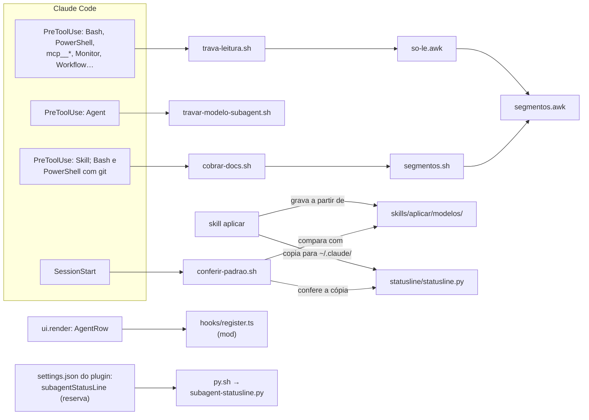
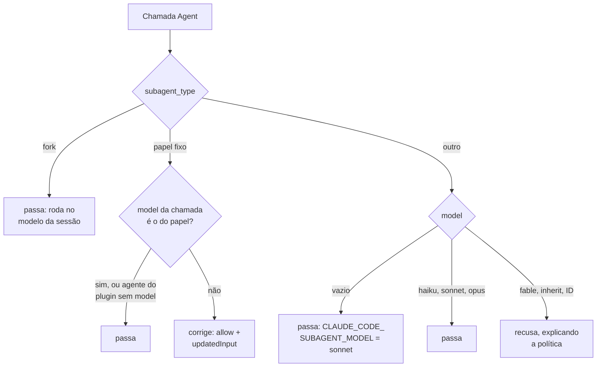
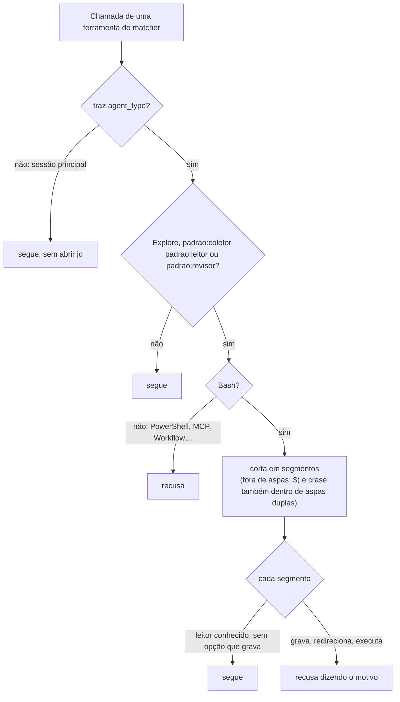
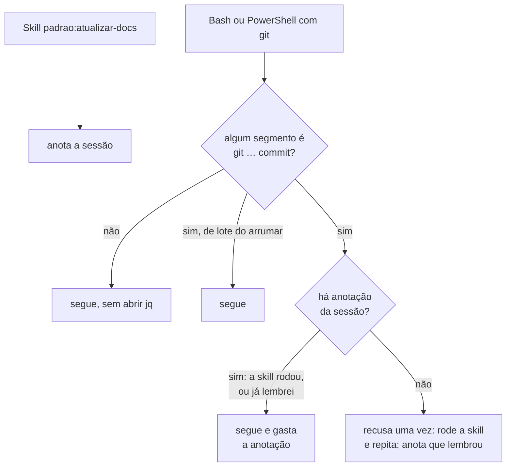
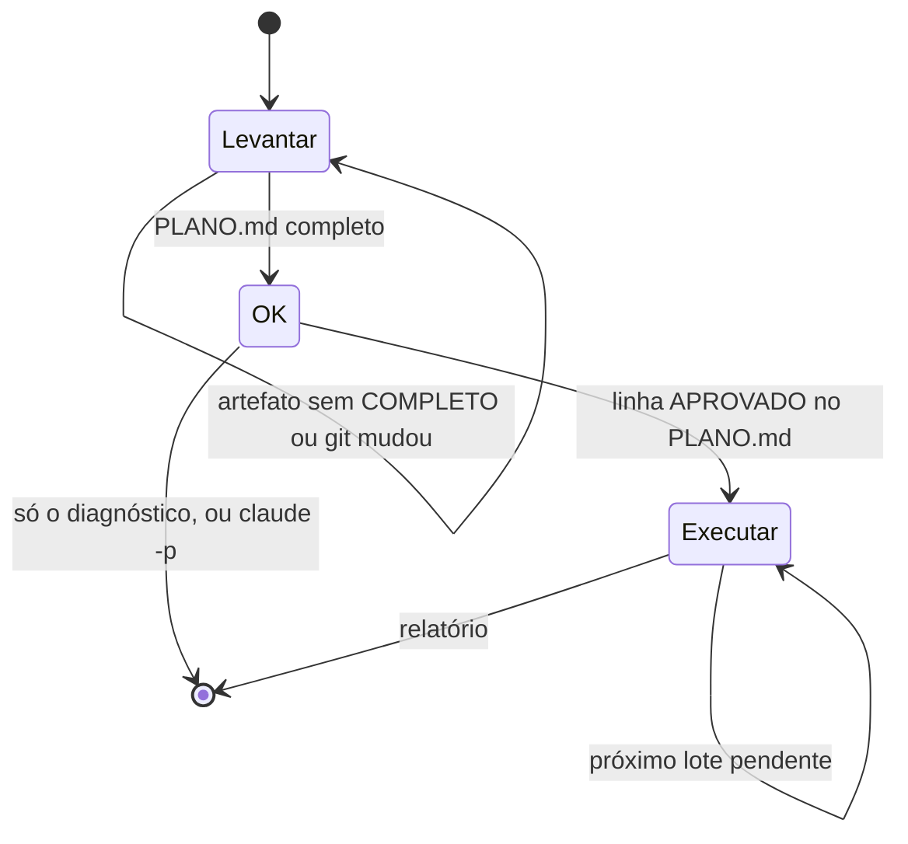

# Como funciona por dentro

Para quem mantém o plugin. O uso está no [README](../README.md); a regra exata de cada hook está
no cabeçalho do script dele — aqui fica como as peças se ligam e por quê.

## As peças

| Caminho | Papel |
|---|---|
| `hooks/hooks.json` | liga os quatro hooks; todos com `shell: bash` e timeout de 10 s (a trava de leitura e o hook de abertura, 30 s); as duas travas com `onFailure: "block"` (falhou, bloqueia), o lembrete da documentação com `onFailure: "continue"` (falhou, o commit segue — por extenso, porque no Code Mode o hook que falha sem a chave recusa a chamada) |
| `skills/aplicar/modelos/` | **fonte única** do padrão: o `aplicar` grava a partir dela e o hook de abertura compara com ela |
| `scripts/py.sh` | acha `python3`, `python` ou `py` 3.9+ (no Windows o `python3` costuma ser o atalho quebrado da Store) e roda com `-I` |
| `agents/*.md` | os quatro agentes; os que só leem têm `tools` fechado e `disallowedTools` |
| `statusline/` | `statusline.py` é de terceiro (Jhonatan de Souza); nossas linhas ficam entre `padrao: início` e `padrao: fim` ou marcadas `# padrao` |
| `scripts/opcional.py` | liga, desliga e mostra os dois opcionais (Code Mode e Fable como advisor); as skills `code-mode` e `advisor` só o chamam — ver [Os opcionais](#os-opcionais--opcionalpy) |
| `hooks/register.ts` | o mod da linha dos subagents: hook `ui.render` em `AgentRow`, declarado em `modules` no `hooks.json`; testes em `hooks/register.test.tsx` |
| `settings.json` | a única setting que o plugin traz: `subagentStatusLine`, reserva da linha dos subagents para versão sem o mod (de plugin só valem ela e `agent`) |

## Hook de abertura — `conferir-padrao.sh`

Roda a cada `startup` e `resume`, e a primeira resposta espera por ele (menos de 1 s; a medição
está no fim desta seção). **Só avisa**: o
que achar vai ao usuário (`systemMessage`) e ao Claude (`additionalContext`), apontando o
`/padrao:aplicar`. Sem `jq`, fica calado.

| Confere | Contra |
|---|---|
| `model`, `effortLevel`, `modelSettings` (todos os campos que o modelo define em cada modelo, inclusive `autoCompactWindow`, que o modelo fixa em 400K no Opus, no Fable 5.2 e no Mythos 5.2; campo ou modelo só do projeto não conta) e as chaves de `env` do projeto | `modelos/settings.json` |
| as mesmas chaves no `.claude/settings.local.json` | o local vence o projeto: chave do padrão lá com outro valor é acusada (ausente ou igual, passa) |
| `fallbackModel` em `settings.json` ou `settings.local.json`; `CLAUDE_CODE_DISABLE_FILE_CHECKPOINTING` | têm de estar ausentes |
| `disableClaudeAiConnectors` (projeto) e `syncClaudeAiPlugins: false` (local, único lugar em que vale) | `true` / `false` |
| `~/.claude/settings.json` | só `permissions.defaultMode`, `skipDangerousModePermissionPrompt`, `autoMemoryEnabled`, a status line principal, o effort que o `/effort` salva (o projeto vence) e, de `env`, só `CLAUDE_CODE_EXPERIMENTAL_CODE_MODE` (o Code Mode só liga do escopo user); outra variável sai no aviso como `env.NOME`. `subagentStatusLine` ali é chave fora do padrão, porque o global vence o plugin, e `advisorModel` também (o `/advisor` grava lá; o lugar dele é o `settings.local.json` do projeto) |
| `~/.claude/` | sem `CLAUDE.md`, agents, commands, rules, workflows, skills pessoais (menos `synced/` e ocultas), `statusline.py` diferente da do plugin, `subagent-statusline.py` sobrando |
| `~/.claude.json` e `~/.claude/projects/<chave>/memory` | sem MCP de escopo user nem local deste projeto; sem memória deste projeto |
| versão instalada × `~/.claude/plugins/marketplaces/claude-padrao` | por **diferença**, não por ordem: a numeração recomeçou em 1.0.0 |
| carimbo `modelo X` do bloco do `CLAUDE.md` e dos `docs/agente/padrao-*.md` do projeto | o da 1ª linha do arquivo em `modelos/`; só o carimbo, não o texto — quem grava no projeto é o Claude, e espaço ou CRLF dariam aviso falso. A marca vale só no começo da linha (prosa que cita o marcador não conta), e carimbo mais novo que o do plugin manda atualizar o plugin, não rodar o `aplicar` |

**Custo.** No Windows abrir um processo custa de 100 a 800 ms, e até a 2.7.1 o hook abria uns 45
(`cat` de cada settings, `sed` de cada carimbo, `ls` de cada pasta). Desde a 2.7.2 os arquivos
são lidos com o `read` do shell, as pastas conferidas por glob e o carimbo tirado sem `sed`:
sobram dois `jq`, um `cmp` e, quando há aviso, o `jq` que monta a saída. Medido lado a lado,
cinco vezes cada, em 2026-11-17, neste repositório (20 avisos):

| | 2.7.1 | 2.7.2 |
|---|---|---|
| hook de abertura | 2,2 a 3,0 s | 0,74 a 0,93 s |
| lembrete da documentação, num `git status` da sessão principal | 0,17 a 0,23 s | 0,11 a 0,22 s |

- **Mesma saída:** a suíte rodou numa cópia em que o hook era um comparador (versão antiga e
  nova no mesmo cenário): seis cenários do `testar.sh` e este repositório, saída idêntica byte
  a byte.
- **Uma mudança de propósito:** a chave do projeto em `~/.claude/projects` passou a sair do `jq`,
  caractere a caractere, como no `medir` e no `inventariar`. O `sed` de antes trocava byte a
  byte, e num caminho com acento dava uma chave diferente da dos scripts Python.
- **Timeout de 30 s** (era 10): com a máquina carregada a versão antiga chegava perto do limite.
- **Duas armadilhas do `read`:** a variável do laço não pode ser `_` (no shell ela vale o último
  argumento do comando anterior e nunca fica vazia: o laço não termina), e o `jq` do Windows
  termina cada linha em CRLF — o CR sai do fim de cada aviso, sem abrir `tr`.

## Linha dos subagents — `hooks/register.ts` (mod) e `settings.json` (reserva)

A linha de cada subagent no painel de agentes vem do plugin, sem cópia em `~/.claude`, por dois
caminhos que desenham o mesmo texto:

| | Mod: `hooks/register.ts` | Reserva: `subagentStatusLine` do `settings.json` |
|---|---|---|
| O que é | módulo TypeScript que o `hooks.json` declara em `modules`; hook `ui.render` no componente `AgentRow` | comando: `py.sh` → `subagent-statusline.py` |
| Vale em | Claude Code 2.1.326+, onde os módulos de plugin estão liberados para a conta | qualquer versão desde a 2.1.319 |
| Custo | roda dentro do Claude Code, sem processo | um Python a cada 5 s com subagent visível (~0,6 s no Windows) |
| Mostra a mais | custo do subagent (a partir de US$ 0,01) e aviso de Haiku acima de 100K (paga 5×) | — |

O `claude plugin validate` avisa que o `subagentStatusLine` está obsoleto e vai parar numa versão
futura, sem data: por isso o mod. A reserva fica enquanto houver versão sem o `AgentRow`. Medido
em 2026-11-17, v2.1.326, em sessão interativa num pseudo-terminal (ver [Testes](#testes)):

- **Os dois convivem.** O `hooks.json` leva `modules` ao lado dos quatro hooks de comando; numa
  sessão real o módulo carregou (`hooks module padrao loaded … events: ui.render`) e os hooks em
  sh agiram (abertura e modelo do `Explore`).
- **Com os dois ativos, o mod vence:** em 98 de 98 desenhos da linha saiu a marca que só o mod
  punha. Sem o `subagentStatusLine`, o mod sozinho desenha a linha.
- **Versão antiga ignora o mod, não quebra.** Nas 2.1.319, 2.1.323, 2.1.324 e 2.1.325 o
  `plugin validate` aceita o `hooks.json` e diz que o `AgentRow` não existe ali ("it never
  runs"): quem desenha é a reserva. O `AgentRow` existe a partir da 2.1.326.
- **Liberação por conta.** O log da sessão mostra os módulos de plugin instalado atrás de uma
  chave de liberação (`tengu_plugin_hooks_modules`): conta sem ela fica na reserva.
- **A API de mods é de acesso antecipado e muda entre versões.** Hook de mod que falha é
  pulado sozinho, e a linha volta a ser a da reserva (ou a do Claude Code). O que o módulo usa
  está em `claude plugin validate .` ("hooks: ui.render{component=AgentRow}; calls:
  $.clock.now").
- **O global ainda vence a reserva:** `subagentStatusLine` em `~/.claude/settings.json` (o
  padrão a punha lá até a 2.2.1) esconde a do plugin. O hook de abertura acusa a chave e a
  cópia antiga do script, e o `aplicar` tira as duas.
- **Mexeu numa, mexa na outra:** as duas linhas têm de dizer o mesmo. Os testes do mod estão em
  `hooks/register.test.tsx` (`claude plugin test .`; o `testar.sh` os roda onde há o `claude`) e
  os da reserva, no `testar.sh`.
- **Arquivos que o Claude Code gera** ao carregar o plugin de uma pasta (`--plugin-dir`):
  `.claude-plugin/types/` (com `.gitignore` próprio) e o `tsconfig.json` da raiz, versionado,
  que só aponta para ela.

## Hook de modelo — `travar-modelo-subagent.sh`

| Papel fixo | Modelo |
|---|---|
| `Plan` | opus |
| `Explore`, `padrao:coletor`, `padrao:leitor` | haiku |
| `padrao:executor`, `padrao:revisor` | sonnet |

- **Precedência do modelo** no Claude Code: `model` da chamada > `model:` do frontmatter >
  `CLAUDE_CODE_SUBAGENT_MODEL` > modelo da sessão. Por isso os agentes do plugin sem `model` passam
  (o frontmatter já tem o certo) e o hook só age quando a chamada traz outro.
- O `Explore` embutido roda no `opus` por padrão: daí a correção sempre.
- `fable` segue recusado em subagent: é o último degrau de escalada da **sessão** (`/model` com
  `s`; amarelo na status line), e o alias está fixado no Fable 5.2 só para não mudar sozinho.
- A correção devolve a entrada inteira com o `model` trocado (`updatedInput` substitui a entrada).
- **O `effort` da chamada fica de fora**, por medição: nas 304 chamadas de subagent do
  histórico local (66 transcripts, 2026-11-17) nenhuma trouxe `effort`. Em vez de regra nova
  no hook, o `medir` conta essas chamadas; se aparecerem, aí se decide recusar `xhigh` e `max`.
- **Sem jq** não dá para reescrever: os campos saem por regex e o papel fixo fora do modelo é
  recusado com o modelo certo na mensagem.

## Trava de leitura — `trava-leitura.sh` → `so-le.awk` + `segmentos.awk`

- **Matcher** (`hooks.json`): Bash, PowerShell, `mcp__*` e as embutidas que executam, gravam ou
  falam com fora (Monitor, Workflow, CronCreate/Delete, RemoteTrigger, Enter/ExitWorktree,
  SendMessage, SendToProject*, PushNotification, TaskStop). Ferramenta nova desse tipo entra
  ali. Não é `*` de propósito: cada chamada abre um `sh`, e no Windows isso custa de 100 a 800 ms.
- **Lista de leitura** (`so-le.awk`): `cat grep head tail wc ls stat diff cmp echo printf jq test
  readlink realpath basename dirname cd pwd cut tr column nl`, mais estes com checagem:

| Comando | Recusado quando |
|---|---|
| `sed`, `awk` | sem `--sandbox` logo após o nome; com `-i` (sed) ou `-d/-p/-o/-D` (gawk), que o sandbox não impede |
| `git` | subcomando fora de `log show diff blame grep status ls-files ls-tree rev-parse rev-list cat-file shortlog merge-base name-rev describe`; `-c`, `--config-env`, `--output`, `--ext-diff`, `--exec-path`, `--git-dir`, `--work-tree`, `-O` |
| `sort`, `uniq`, `find`, `file`, `rg` | opção que grava ou executa (`-o`, dois operandos, `-exec`/`-delete`/`-fprint`, `-C`, `--pre`/`--hostname-bin`) |
| qualquer segmento | `>` que não seja `>/dev/null` ou `2>&1` |

- **Opção longa abreviada conta:** o GNU e o git aceitam `--outp`, `--in-pl`, `--pro`, `--op` no
  lugar do nome inteiro, e o git aceita `-O` colado a outras opções curtas (`-nO./prog`). A
  trava casa o menor prefixo que já não é ambíguo (`--o` e `--co` no sort, `--i` no sed, `--d` e
  `--pr` no awk, `--op` e `--outp` no git, `--co` no file) e o `O` em qualquer posição do grupo.
  Até a 2.4.1 casava o nome inteiro: `git grep --op=./prog` executava programa e
  `sed --sandbox --in-pl` gravava no lugar. Opção nova que grave ou execute entra pelo prefixo.
- **Por que `--sandbox`:** sed e awk são linguagens. `s|a|b|e` executa comando com qualquer
  delimitador, e o gawk chama `system()` por chamada indireta (`@f`); nenhum filtro de texto
  fecha isso. O `--sandbox` do GNU sed recusa `e/r/w`, e o do gawk, `system`, redirecionamento e
  extensões. O mawk não tem a opção: falha, e fica fechado.
- **Um jq e um awk por chamada.** No Windows abrir um processo custa de 100 a 800 ms (antivírus
  corporativo). Até a 2.5.2 a trava abria uns 20 por comando (`jq`, `sed`, `awk`, `grep`, um par
  por segmento): com quatro sessões do revisor em paralelo, estourou os 10 s do hook em 5 de 12
  e o agente ficou sem Bash. Desde a 2.6.0 a `trava-leitura.sh` lê a entrada com o `read` do
  shell (a sessão principal sai sem abrir processo), um `jq` tira agente, ferramenta e comando e
  um `awk` decide: `so-le.awk` tem a regra, `segmentos.awk` o corte. Medido lado a lado, cinco
  vezes cada, em 2026-11-17:

| Chamada | 2.5.2 | 2.6.0 |
|---|---|---|
| agente que só lê, `git diff HEAD` | 1,3 a 1,6 s | 0,21 a 0,29 s |
| agente que só lê, comando de 5 segmentos | 1,1 a 1,5 s | 0,17 a 0,39 s |
| sessão principal | 0,21 a 0,23 s | 0,14 a 0,16 s |

  O timeout do hook segue em 30 s, de folga.
- **A reescrita foi conferida contra a versão anterior:** 190 comandos (as listas do
  `testar.sh` e formas difíceis: aspas abertas, heredoc, crase, `$(…)`, várias linhas) passaram
  pelas duas e deram os mesmos segmentos, a mesma decisão e o mesmo motivo; sete tipos de agente
  × quatro ferramentas no `trava-leitura.sh`, idem. Mexeu na regra: repita a comparação com a
  versão do commit anterior (`git show <commit>:scripts/so-le.awk`).
- **awk POSIX.** Os dois `.awk` rodam em gawk, mawk e busybox: sem `gensub`, sem classes
  `[[:space:]]` e sem intervalo `{n}`. O `--sandbox` que a trava exige do sed e do awk do
  AGENTE é outra coisa: é do comando analisado, não do awk que analisa.
- **Risco que fica:** `cd` ou `git -C` para dentro de um repositório bare versionado com config
  hostil (`core.fsmonitor`). `safe.bareRepository=explicit` no git do usuário fecha.

## Lembrete da documentação — `cobrar-docs.sh`

A regra "antes de todo commit, a `padrao:atualizar-docs`" morava só no bloco do `CLAUDE.md`.
Medida em 14 dias de histórico local, a skill rodava antes de cerca de 4% dos commits (todos da
sessão principal, pelo Bash). Instrução depende de o modelo lembrar; o que tem hora certa vai em
hook.

- **Lembrete, não trava.** A segunda tentativa passa sempre. O hook não sabe se o diff tem algo
  documentado, e commit preso é pior que doc velha. Por isso também **falha aberto**: sem `jq`,
  sem `session_id` ou sem onde anotar, ele se cala.
- **Um commit, uma passada.** O commit que passa apaga a anotação; o seguinte pede a skill de
  novo. Commit que falha depois de passar pelo hook custa um lembrete a mais (menos de 1% dos
  commits do histórico).
- **Por sessão, não por repositório.** A anotação é `${CLAUDE_PLUGIN_DATA}/docs-<session_id>`.
  Cerca de 12% dos commits do histórico rodam fora do cwd da sessão (`cd outro && git commit`,
  `git -C`): amarrar ao HEAD de um repositório erraria nesses. A skill, ao anotar, varre as
  anotações de mais de 7 dias.
- **Filtro `if`** (`hooks.json`): `Bash(git *)` e `PowerShell(git *)`, um handler por ferramenta
  (o `if` leva uma regra só). Medido na v2.1.322: dispara em commit encadeado (`cd x && git add
  && git commit`), com atribuição na frente, com `git -C` e com heredoc; não dispara em `ls` nem
  em `echo "git commit"`. `Bash(git commit*)` perderia o `git -C x commit`. O filtro é de melhor
  esforço (dispara também em crase e `$()` que cita git): quem decide é o script.
- **O que é commit** para o script: segmento (`segmentos.sh`) que começa por `git`, com ou sem
  opções globais (`-C dir`, `-c k=v`, `--no-pager`), e subcomando `commit`. Antes do corte sai o
  corpo dos heredocs: o segmentador parte na crase, e texto que cita `git commit` entre crases
  (uma entrada de `AGENT_LEARNINGS.md` gravada por `cat <<EOF`) virava commit.
- **Fora:** os lotes do `/padrao:arrumar` (mensagem que começa por `arrumar: lote `, em `-m "…"`
  ou na 1ª linha do heredoc; o plano já cuidou da documentação) e o commit que o usuário roda no
  terminal, que não é chamada de ferramenta. Citar `arrumar: lote` em outro ponto do comando não
  isenta.
- **Escapam, e o commit segue sem lembrete:** `bash -c "git commit"`, alias (`git ci`) e opção
  global com o valor separado (`--git-dir x commit`). Nenhuma apareceu no histórico; o erro é
  sempre para o lado de deixar passar.
- **O texto da recusa** diz que é rotina e que não vai para o `AGENT_LEARNINGS.md`: o Claude
  Code a mostra como `hook error`, e sem isso o modelo a registrava como erro. O `medir` conta os
  lembretes por esse texto — mudou a frase, mude o `LEMBRETE` do `medir-modelos.py`.

## As skills

**`aplicar`** — o `inventariar.py` só lê e imprime JSON com o destino de cada item (`DESTINO`,
`PERMISSOES` e `SEGREDO` no topo do script): `padrao` (o modelo define), `time`, `local`,
`global`, `avaliar` (pergunte) ou `descartar`. Do `env` e dos MCP saem só os nomes. Os arquivos
que vão para o projeto saem de `modelos/`; o bloco do `CLAUDE.md` fica entre
`<!-- padrao:inicio` e `<!-- padrao:fim -->` e é substituído inteiro a cada `aplicar`.
Projeto com `AGENTS.md`: o plano propõe `@AGENTS.md` na primeira linha do `CLAUDE.md` da mesma
pasta. O Claude Code lê um ou outro — conferido na v2.1.322, com uma palavra-código que só
existe no `AGENTS.md`: sem import ela some, na raiz e em subpasta; com import, volta. A opção
que liga os dois (`pluginConfigs`) só vale no settings global, fora do padrão; o import mora no
projeto. O `arrumar` acha o mesmo caso na carga fixa.

LSP no `aplicar` é oferta, e só com o binário já no `PATH`. Medido na v2.1.322, no Windows, com
o `pyright-lsp` e o Pyright do npm num projeto Python público de 13 mil linhas:

- o servidor sobe (o atalho `.cmd` do npm serve) e o Claude recebe a ferramenta `LSP`
  (`workspaceSymbol`, `findReferences`, `hover`) e os diagnósticos de tipo — estes na chamada de
  ferramenta seguinte à edição, e só para `Edit`/`Write` (edição por `sed` no Bash não dispara);
- a ferramenta `LSP` é adiada: o modelo a carrega pelo `ToolSearch` quando decide usá-la. Em
  duas tarefas iguais com e sem o plugin (achar as chamadas de um método entre homônimos;
  renomear um método no código e nos testes), o resultado, os turnos e o custo foram os mesmos,
  e o Claude não chamou o `LSP` em nenhuma: resolveu por grep. Sem o plugin em uso, o contexto
  não cresce;
- `claude plugin install <plugin>@claude-plugins-official --scope project` grava só o
  `enabledPlugins` do projeto (e reordena as chaves do arquivo). O marketplace oficial já vem
  registrado numa instalação normal; num HOME novo de teste é preciso adicioná-lo, e no Windows
  o clone dele estoura os 260 caracteres sem `core.longpaths`.

**`arrumar`** — o estado mora em `_audit/` (no `.gitignore`), e é ele que permite retomar:

| Artefato | O que guarda |
|---|---|
| `ESCOPO.md`, `SISTEMA.md`, `INFRA.md`, `CONFRONTO.md` | o levantamento; cabeçalho com branch, commit e `git status`, fim `<!-- COMPLETO -->` |
| `PENDENCIAS.md` | um id por achado (`DOC-*`: Gap, Divergência, Obsoleto, Duplicado, Excesso, Fora do lugar; `INF-*`: Desvio), com evidência `arquivo:linha` e status |
| `PLANO.md` | lotes com verificação checável, decisões assumidas, `<!-- APROVADO … -->` e a situação de cada lote |
| `raw/` | saída bruta dos subagentes |

As **checagens** da trilha B moram em `skills/arrumar/checagens.md`: seis de segurança (`S1`–`S6`)
e quatro de CI (`C1`–`C4`), cada uma com "Vale quando", o comando que confere, o desvio, a
gravidade e o destino da correção.

- **No plugin, não no projeto:** não pesa no contexto de quem usa, atualiza com o plugin e não
  tem carimbo. No bloco do `CLAUDE.md` carregaria em toda requisição de todo projeto, e a
  maioria dos itens não vale para a maioria deles.
- **"Vale quando" e evidência** seguram o falso positivo: os itens de CI pedem tempo medido pelo
  `gh` (um CI de 18 s, como o deste repositório, não gera desvio), e auditoria de dependência só
  roda com a ferramenta já instalada.
- **Correção `infra`, `código` ou `usuário`:** só a primeira entra em lote. O `arrumar` não altera
  código, e segredo exposto se resolve revogando a chave — vai no topo do relatório.
- **Os comandos de segredo não imprimem o valor** (`cut -d: -f1,2`, `--name-only`). O padrão `P`
  cobre formatos comuns de token; não é scanner de entropia.
- **Medido em sessão real** (v2.1.326, Windows, `claude -p "/padrao:arrumar só infra"` com HOME
  falso, uma rodada por projeto; para no plano, por não ter como perguntar):

| Projeto | Resultado | Tempo | US$ |
|---|---|---|---|
| API Node com sete desvios plantados | os sete achados (`S1`–`S6`, `C3`), com `arquivo:linha` ou commit | 165 s | 0,74 |
| a mesma API, limpa | nenhum desvio das checagens | 190 s | 0,82 |

  Nos dois, `C1`, `C2` e `C4` saíram `não verificável` (sem remote, o `gh` não tem o que
  medir) e não viraram desvio; os tokens falsos não foram parar em `_audit/` nem na resposta; e
  o plano pôs em lote só o que é `infra` — token no código, chave no histórico e dependência
  vulnerável ficaram de fora e abriram o relatório.
- **Fase 3 com os lotes de infra, medida** (v2.1.326, a mesma API com os desvios plantados:
  `claude -p "/padrao:arrumar só infra"` e depois `--resume <id> "Aprovar e executar"`; US$ 0,54
  no plano e US$ 1,26 na execução, uma rodada). Três lotes, um commit cada no branch
  `padrao/arrumar-<data>`, sem push: CI (`pull_request` no lugar de `pull_request_target`,
  `permissions: contents: read`, sem o segredo, com o lint), compose em modo produção com um
  Dockerfile novo, e `.env` no `.gitignore` com um `.env.example` só de nomes. Nenhum arquivo de
  `src/` mudou, o `.env` não entrou em commit, os tokens falsos não aparecem nos diffs, em
  `_audit/` nem na resposta, e o `docker build` saiu como `não verificado` (Docker parado). O
  relatório abre com os dois segredos expostos, e o revisor achou um defeito antigo (build sem
  `@types/node`), que ficou em aberto por pedir mudança no lockfile.
- **Não medido:** `C1`, `C2` e `C4` com tempo de CI real (pede um repositório no GitHub com
  execuções) e outra stack que não Node. O `revisor` não lê a
  lista: entra depois de haver uma avaliação dele.

**`atualizar-docs`** — `user-invocable: false`: fora do menu. Quem a dispara é o modelo: o bloco
do `CLAUDE.md` manda chamá-la antes de todo commit, e o `cobrar-docs.sh` cobra na hora do
`git commit` (só a linha do bloco, no uso real, cobria cerca de 4% dos commits).

**`medir`** — lê `~/.claude/projects/<chave>/*.jsonl` e os `subagents/`. O modelo de cada chamada
é o efetivo pela regra do hook; chamada recusada não conta como rodada; tokens por `message.id`
(as linhas de uma resposta repetem o uso). Commits da sessão principal: reconhecidos pela regra do
`cobrar-docs.sh` (sem os do `arrumar`), refeita em regex — em forma rara os dois podem divergir, com a `atualizar-docs` chamada desde o commit anterior
ou não; tentativa que o hook recusou conta como lembrete, não como commit. Dos mesmos commits sai a
linha de verificação: teste, build ou lint rodado na sessão desde o commit anterior (`VERIFICA`,
pelos nomes comuns, no começo de um segmento do comando), chamada ao `padrao:revisor` ou lote
pelo `padrao:executor`; a verificação vista antes de uma tentativa recusada vale para a
repetição. É o modo de observação de um gate que não existe: neste repositório, em 14 dias,
21 de 26 commits tiveram teste ou build antes, e os 5 sem nenhuma decidem se o gate vale. Cada `message.id` é uma requisição: o custo estimado
sai da tabela `PRECO` (preço de lista por milhão, com a data da fonte em `PRECO_EM`, que sai no
cabeçalho; modelo casado por prefixo, escrita de cache de
1 h à parte da de 5 min); contexto = entrada + cache lido + escrita, distribuído em faixas na
sessão principal; Haiku acima de 100.000 paga a requisição inteira no preço alto. Modelo fora da
tabela não entra no custo nem nas faixas e é listado à parte. Mensagem `<synthetic>` (aviso do
Claude Code; no Code Mode, cada chamada feita de dentro do código) não é requisição: o
`tool_use` dela conta para commits e subagents, e ela fica fora de tokens, turnos e custo.
Consulta ao advisor: os tokens do modelo consultado vêm em `usage.iterations` (entrada
`advisor_message`), fora do uso de topo da mensagem; o script os soma numa linha `advisor`
(consultas, tokens e custo), fora das faixas de contexto e dos turnos.

## Os opcionais — `opcional.py`

Code Mode e advisor são recursos experimentais do Claude Code. O padrão não liga nenhum dos dois
nem muda a política de modelos por causa deles: as skills `code-mode` e `advisor`
(`disable-model-invocation`: só o usuário chama) rodam o `scripts/opcional.py`, que grava ou tira
uma chave e mostra o estado.

| | Code Mode | Fable como advisor |
|---|---|---|
| Chave | `env.CLAUDE_CODE_EXPERIMENTAL_CODE_MODE: "1"` | `advisorModel` |
| Arquivo | `~/.claude/settings.json` | `.claude/settings.local.json` do projeto |
| Por que ali | o Claude Code só aceita a variável do shell, do settings do usuário ou de um `--settings`; do projeto e do local ele a descarta | a chave vale em qualquer settings, então não precisa do global; pessoal porque o Fable custa mais e pode consumir créditos de uso de quem ligou |
| Valor | `"1"`; desligar tira a chave (um `"0"` venceria até o `1` do shell) | o ID de `env.ANTHROPIC_DEFAULT_FABLE_MODEL` do `modelos/settings.json`, não o alias `fable`, que acompanha a versão do Claude Code |

- **O global ganhou uma exceção, e só uma.** O hook de abertura deixa passar a variável do Code
  Mode, o inventário a classifica como `global` e o `aplicar` a mantém. `advisorModel` no global
  segue acusado; o inventário o manda para o `settings.local.json` (destino `local`).
- **O script não conserta arquivo.** JSON inválido, ou `env` que não é objeto: para com erro e
  não grava. Regrava com a indentação e o fim de linha do original, por arquivo temporário na
  mesma pasta. Do home, o advisor é recusado: lá o `settings.local.json` seria global.

**Advisor, medido em sessão real** (v2.1.325, Windows, Opus 5.5 medium, três sessões `claude -p`
da mesma tarefa: renomear um script citado em 13 arquivos; as três passaram no aceite):

| Sessão | Consultas | Tempo | US$ |
|---|---|---|---|
| sem advisor | 0 | 33 s | 0,22 |
| advisor ligado pelo `opcional.py` | 0 | 37 s | 0,22 |
| advisor ligado, com o prompt pedindo duas consultas | 2 | 146 s | 1,34 (1,03 do Fable) |

- **Ligado não é consultado à toa:** em tarefa mecânica o Opus não chamou o advisor, e a sessão
  custou o mesmo. Quem decide é o modelo; pedir no prompt funciona.
- **Cada consulta custou uns US$ 0,50:** o Fable leu a conversa inteira sem cache (37K e 44K
  tokens de entrada) e devolveu cerca de 4,7K de saída. Com duas, a sessão saiu 6 vezes mais
  cara e 4 vezes mais lenta. Cresce com o contexto: em sessão longa cada consulta relê tudo.
- **No transcript:** a consulta é um bloco `server_tool_use` de nome `advisor`, e a resposta vem
  cifrada (`advisor_redacted_result`: a orientação não dá para ler dali). Os tokens ficam em
  `usage.iterations`, numa entrada `advisor_message` com o `model`, **fora** do uso de topo da
  mensagem; o `medir` soma essas entradas e mostra o advisor à parte.
- **Configuração:** com `advisorModel` no `settings.local.json` da pasta, `claude -p "/advisor"`
  responde `Advisor: Fable 5.2`; sem ele, `Advisor: off`. No Git Bash o argumento precisa de
  `MSYS_NO_PATHCONV=1`, senão `/advisor` vira caminho e segue como prompt.
- **Não medido:** se a orientação melhora o resultado (a tarefa era mecânica) e os subagents
  herdando o advisor — isso vem só da documentação: executor, revisor e coletor podem consultar
  o Fable, e o hook de modelo não vê, porque o advisor não é o `model` da chamada.

**Code Mode, medido em sessão real** (v2.1.325, Windows, uma sessão interativa em pseudo-terminal
com HOME falso, o plugin e um plugin-sonda que grava a entrada de todo hook):

- **Liga e desliga.** Com a variável gravada pelo `opcional.py` no settings do usuário, a sessão
  abre no diálogo de confirmação (a opção marcada é **No**) e depois mostra
  `Code Mode (experimental) is on`; com ele ligado, o `--continue` retoma a sessão. Desligado
  pelo script, o `--continue` é recusado com a instrução de pôr a variável em 1, e a sessão
  nova abre sem Code Mode.
- **Os hooks valem dentro do código.** O código roda numa chamada `REPL` (`tool_input.code`), e
  cada chamada que ele faz dispara `PreToolUse` e `PostToolUse` com o nome normal (`Bash`,
  `Read`, `Edit`, `Skill`, `Grep`…) e os mesmos campos. `Agent` e `Poll` (espera de código em
  segundo plano) o modelo chama direto.
- **Lembrete da documentação:** o `git commit` de dentro do código foi recusado uma vez (o
  modelo recebe a lista de chamadas recusadas, com o texto do hook), a skill rodou por
  `tools.Skill(...)` (o hook a vê como `Skill`) e o commit seguinte passou.
- **Hook de modelo:** o `Explore` sem `model` rodou em Haiku nas quatro chamadas — o
  `updatedInput` vale ali.
- **Trava de leitura:** os subagents também rodam em Code Mode (o `Explore` usou `REPL`; o
  coletor, com `tools:` fechado, fez direto a única chamada dele), e as chamadas de dentro do
  código deles chegam ao hook com `agent_type`: um `date` do `Explore` foi recusado pela trava.
  O ambiente é selado (`require` não carrega módulo; sem `process` nem `fetch`), e num agente
  sem a ferramenta `Write` a função `write()` falha com `Write tool is not available in this
  REPL context`. Por isso o `REPL` fica fora do matcher: o que grava continua passando por
  ferramenta, e cada ferramenta pelo hook.
- **`medir`:** o transcript grava cada chamada de dentro do código como mensagem `<synthetic>`
  (`isVirtual`, uso zerado) com o `tool_use` normal. Commits, lembretes, subagents e correções
  saíram iguais ao registro da sonda; `<synthetic>` não entra em tokens nem em turnos.
- **Não medido:** hook que falha ou estoura o tempo dentro do Code Mode — o
  `onFailure: "continue"` do lembrete vem da documentação; `revisor` e `leitor` (mesma
  configuração do coletor); auto mode.

**Ganho do Code Mode, medido** (v2.1.325, Windows, Opus 5.5 medium, uma cópia deste repositório
com o padrão aplicado e defeitos plantados). Três tarefas na mesma sessão, com o aceite escrito
antes: achar os links quebrados dos .md, renomear um script citado em 10 arquivos e rodar seis
verificações independentes. Custo a preço de lista, pelo transcript:

| Rodada | Requisições | Tempo | US$ | Contexto por requisição |
|---|---|---|---|---|
| sem Code Mode (3 rodadas) | 9–10 | 72–77 s | 0,39 | 49K → 61K |
| com Code Mode, cache quente (1) | 9 | 82 s | 0,34 | 26K → 39K |
| com Code Mode, cache frio (1) | 11 | 91 s | 0,47 | 26K → 39K |

- **Mesma qualidade:** as cinco rodadas passaram em todo o aceite, e o `testar.sh` do projeto
  passou depois da renomeação em todas.
- **Não poupou requisição.** Sem Code Mode o Opus já resolve cada tarefa com dois ou três
  comandos de shell (`grep | xargs sed`, um script Python no heredoc); o Code Mode embrulha os
  mesmos comandos em JavaScript.
- **O ganho vem do contexto menor:** a sessão com Code Mode abre com 26,1K tokens, contra
  48,7K da comum, e a diferença de uns 22 mil segue em toda requisição. Com o cache quente isso
  deu 13% a menos nesta sessão curta; é um valor fixo por requisição (cache lido), então pesa
  menos quanto maior o contexto da sessão.
- **Cache frio custa caro:** o prefixo do Code Mode é outro, e a primeira sessão com ele o
  regrava inteiro (26 mil tokens de escrita de 1 h) — saiu 21% mais cara que a sessão comum,
  cujo prefixo estava quente. Quem liga e desliga paga isso a cada troca.
- **Um pouco mais lento:** 82 e 91 s de relógio, contra 72 a 77 s.

Sessão mais longa, com delegação: quatro tarefas na mesma sessão — ler cinco arquivos grandes,
uma coleta pelo `padrao:coletor`, um lote de 13 arquivos pelo `padrao:executor` com o diff
conferido pelo `padrao:revisor`, e as seis verificações na sessão principal. Duas rodadas por
braço:

| Rodada | Requisições da sessão | Tempo | US$ sessão | US$ subagents | US$ total | Contexto máximo |
|---|---|---|---|---|---|---|
| sem Code Mode, 1 | 15 | 194 s | 1,40 | 0,20 | 1,61 | 144K |
| sem Code Mode, 2 | 15 | 304 s | 1,37 | 0,11 | 1,48 | 138K |
| com Code Mode, 1 | 19 | 176 s | 1,27 | 0,15 | 1,42 | 115K |
| com Code Mode, 2 | 17 | 163 s | 1,20 | 0,12 | 1,32 | 113K |

- **11% a menos nas duas rodadas**, com o mesmo aceite e a mesma delegação (um coletor, um
  executor e um revisor em cada sessão) e o `testar.sh` do projeto passando depois do lote.
- **Mais requisições, não menos** (17 a 19 contra 15): a economia continua vindo do contexto,
  25 a 30 mil tokens menor do começo ao fim. O custo dos subagents ficou na mesma faixa.
- **Tempo:** 163 e 176 s contra 194 e 304 s; a rodada de 304 s teve uma verificação lenta na
  última tarefa, então a diferença de relógio não é conclusiva.
- **Limites:** contexto até 144K, delegação pedida no prompt, um repositório, duas ou três
  rodadas por braço. Sessão de centenas de milhares de tokens e tarefa com muita chamada que o
  shell não faz (MCP, `WebFetch`, vários `Agent`) não foram medidas.

Somando as duas medições: 11 a 13% a menos com o cache quente, sem poupar requisição, e mais
caro na primeira sessão depois de ligar. É ganho real e pequeno; por isso a política de
modelos não mudou e o Code Mode segue opcional.

## Testes

`bash scripts/testar.sh` (e o CI, no Ubuntu) confere:

- as decisões dos quatro hooks, inclusive sem `jq` e as brechas já fechadas da trava;
- o lembrete da documentação: as formas de commit do histórico, o que não é commit, a sequência
  recusa → repetição → commit seguinte, a skill liberando só a própria sessão e a falha aberta;
- que o `--sandbox` do sed e do gawk segura de verdade o que a trava deixa passar;
- o hook de abertura com HOME e projeto falsos, limpo e sujo;
- que nenhum modelo de `skills/aplicar/modelos/` mudou sem subir o carimbo (soma do texto);
- as duas status lines, o comando do `settings.json` do plugin (com o `${CLAUDE_PLUGIN_ROOT}`
  trocado), o inventário (não imprime valor do `env`) e as contas do `medir`
  (inclusive custo, faixas de contexto, Haiku acima de 100K, consulta ao advisor e período sem
  requisição);
- as checagens do `arrumar`: todo item com os cinco campos, e o padrão de segredo casando token
  nos formatos conhecidos (na árvore e no histórico, sem imprimir o valor) e não casando prosa;
- a regra de "o que é commit" nas suas duas cópias: as mesmas entradas passam pelo
  `cobrar-docs.sh` e pelo `faz_commit` do `medir-modelos.py` e têm de dar a mesma resposta;
- os opcionais: ligar, desligar e estado do `opcional.py` com HOME e projeto falsos (o resto do
  settings, a indentação e o CRLF preservados; JSON inválido intocado; o home recusado), a
  variável do Code Mode calada no hook de abertura e o `onFailure` de cada hook no `hooks.json`.

O CI roda o mesmo `testar.sh` num job `testar-windows` (Git Bash da imagem do GitHub). Entrou em
observação (`continue-on-error`) e passou a reprovar depois de três execuções verdes seguidas:
gate novo começa sem reprovar.

O CI tem ainda um job `diagramas`, que passa todo bloco Mermaid dos .md pelo parser oficial
(`.github/scripts/validar-mermaid.mjs`, com `mermaid` e `jsdom` instalados só ali). O parser não
vê layout: diagrama novo, abra numa página local antes, porque largo demais fica ilegível no
GitHub e título de bloco (`subgraph`) longo é cortado.

**Avaliação do revisor** (`avaliacao/revisor/`): um projeto de exemplo (`base/`, uma loja em
Python com testes) e 18 diffs sobre ele em `casos.py` — 12 com um defeito plantado e o gabarito
(arquivo, linha e uma frase) e 6 limpos de controle. Oito defeitos são diretos (a linha errada
está no diff); quatro são difíceis: quem chama a função mudada está num arquivo fora do diff,
uma troca de `==` por `is` no meio de um diff de 15 anotações de tipo, reserva de estoque sem
desfazer, dinheiro em float. Dos controles, um fica ao lado de um defeito antigo, um é o mesmo
diff grande sem a troca e um é a nova tentativa de cobrança escrita certo. O
`avaliar.py` abre uma sessão `claude -p --agent padrao:revisor` por caso, com a ficha do lote, e
lê a linha `ACHADOS:` do fim da resposta: o caso com defeito acerta se ela cita o arquivo a até
3 linhas do gabarito; o de controle, se diz `nenhum`. O script confere o lugar; se o achado
descreve o defeito, quem confere é a pessoa, pela frase do gabarito. `--conferir` roda no
`testar.sh` e não custa: aplica cada diff e roda os testes do caso (que passam com o defeito —
defeito que o teste do próprio diff pega não mede o revisor).

Medido (v2.1.326, Windows, Sonnet 5.5, uma sessão por caso, quatro em paralelo):

| Rodada | Defeitos | Controles | Achados a mais | Custo | Tempo por caso |
|---|---|---|---|---|---|
| 12 casos, trava da 2.5.2 | 8 de 8 | 4 de 4 | 6 | US$ 0,31 | 18 a 51 s |
| 18 casos, trava da 2.6.0 | 12 de 12 | 6 de 6 | 11 | US$ 0,46 | 9 a 22 s |

- **Todos na linha do gabarito e descritos como nele**, inclusive os quatro difíceis: no caso do
  arquivo fora do diff o revisor foi até `checkout.py`; no diff grande, achou só a troca de
  `==` por `is`. Os achados a mais são reais (o teste do diff não pega o defeito; um efeito
  colateral dele). Nenhum achado falso nos controles; o defeito antigo saiu na lista à parte.
- **O conjunto saturou, com os difíceis e tudo.** Nota máxima não distingue um prompt bom de um
  ótimo: serve de regressão (mexeu no `agents/revisor.md`, rode de novo), não para afinar.
  Caso inventado não chega onde o revisor erra; o que falta são os bugs de verdade que
  escaparam em projetos reais — cada revert vira um caso, com a frase do gabarito.
- **Uma rodada por caso** é amostra de um. Na primeira, a trava de leitura estourou o tempo em
  5 dos 12 e o revisor deduziu o diff lendo os arquivos (acertou mesmo assim); na segunda, com
  a trava nova, não estourou em nenhum e o tempo por caso caiu pela metade. O revisor não roda
  `python -m unittest` (não é comando de leitura) e diz isso na resposta.
- **Como rodar:** `sh scripts/py.sh avaliacao/revisor/avaliar.py --saida <pasta>`, com HOME falso
  e o token na env, como no teste de ponta a ponta abaixo, para não gravar no `~/.claude` real.

Não cobre o texto das skills. Para elas, o **teste de ponta a ponta**:

1. Projeto de exemplo no scratchpad, com documentação errada de propósito, e um HOME falso com
   um global sujo (modelo, effort, token, MCP, memória, `CLAUDE.md` global).
2. `claude -p --plugin-dir <este repo> --dangerously-skip-permissions --output-format json`,
   com `HOME` e `USERPROFILE` apontando para o HOME falso, sem as variáveis `CLAUDE*` da sessão
   e o login por `CLAUDE_CODE_OAUTH_TOKEN` — o `accessToken` do `.credentials.json`, só na env:
   não copie o arquivo, que tem o refresh token e tokens de MCP.
3. Etapa que pede OK: `--resume <session_id> "<resposta>"` (no `-p` não há `AskUserQuestion`).
4. Confira o resultado com scripts (arquivos, commits, `conferir-padrao.sh` calado) e que o
   `~/.claude` real não mudou. Uma rodada completa (`aplicar`, hooks, `arrumar`) custa ~US$ 4.
5. Lembrete da documentação: peça uma mudança com commit autorizado num projeto com o padrão
   aplicado e confira no transcript a ordem das chamadas. Com o bloco inteiro, `Skill` antes do
   `git commit` e nenhuma recusa; com o bloco sem a linha "Antes de todo commit", recusa →
   `Skill` → commit. O que o hook recebe (campos, `if`, `CLAUDE_PLUGIN_DATA`) se sonda com um
   plugin de um hook só que grava a entrada, num `--plugin-dir` a mais.

O que só a interface mostra (linha dos subagents, status line, diálogos) não aparece no
`claude -p`. Para isso, uma sessão interativa num pseudo-terminal: um script Node com
`@lydell/node-pty` (sobe o `claude` com o HOME falso e o token na env) e `@xterm/headless`
(remonta a tela), gravando a tela em texto a cada mudança. No HOME falso, ponha
`hasTrustDialogAccepted` para a pasta em `.claude.json` e `skipDangerousModePermissionPrompt`
no settings, senão a sessão para nos diálogos de abertura. É o único jeito de testar o Code
Mode, que não roda em `claude -p`: o diálogo dele abre com **No** marcado (seta para baixo e
Enter — confira na tela o cursor no **Yes** antes do Enter e o aviso `is on` depois: seta
mandada cedo demais se perde, e a sessão abre sem Code Mode). `autoUpdates: false` no `.claude.json` falso vira `env.DISABLE_AUTOUPDATER` no settings
global, e o hook de abertura acusa. Com um servidor de linguagem instalado, o diálogo de LSP
aparece no meio da sessão. Texto que começa por `/` (`/exit`) passado pelo Git Bash ao script
que digita na sessão pede `MSYS_NO_PATHCONV=1`.

**`claude plugin eval`: ensaiado, não adotado** (v2.1.322, Windows, três casos de teste). Roda
com a assinatura, guarda o relatório local e custa ~US$ 0,10 por rodada, mas não alcança o que
este plugin precisa testar:

- caso que pede Bash é recusado no Windows nativo, porque não há sandbox (`no sandbox backend on
  this platform`). É onde mora quase tudo: o lembrete do commit, o `aplicar`, o `arrumar`, o
  `medir`. Em Linux, macOS ou WSL2 roda; em CI pede API key, `bubblewrap` e `socat`;
- nada de projeto carrega na rodada (`CLAUDE.md`, `.claude/`): as regras do bloco ficam de fora,
  e o hook de abertura acusa "padrão fora do lugar" em toda rodada;
- os arquivos de `context.add_dirs` não aparecem na pasta de trabalho: o Claude não os achou em
  nenhuma rodada; fixture pede `scaffold_script`.

O que rodou: a `atualizar-docs` foi chamada por frase natural só com o plugin carregado, e o
`Explore` rodou em Haiku pelo hook de modelo (no `trace` isso aparece no `model` das mensagens
do subagent; o texto do hook não entra). Vale rever quando o time tiver máquina com sandbox ou
quando o sandbox do Windows sair de trás do `feature gate` que a recusa cita.

No Windows, o caminho do HOME falso no scratchpad passa de 260 caracteres dentro de
`.claude/projects/`: Python e o `jq` nativo não abrem — leia com `cat arquivo | jq` e, para o
`medir`, copie os transcripts para um HOME curto.

## Publicar

Suba a `version` em `.claude-plugin/plugin.json` (semver) a cada mudança publicada — o
marketplace pina por ela, e o aviso de versão nova compara com ela —, rode os testes e dê push.
Mudou `claude-md.md` ou `agente/padrao-*.md`: suba o `modelo X` da 1ª linha para a versão nova e
registre-o com a soma em `scripts/testar.sh` — é o carimbo que faz o hook de abertura avisar o
projeto que ficou com o texto antigo.
O `marketplace.json` publica este mesmo diretório (`source: "./"`).
